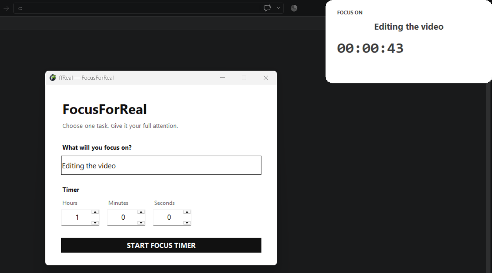

# ffReal — FocusForReal

A tiny Windows focus timer that keeps your current task visible while you work.



## What it does

Enter one task, choose a duration, and start focusing. ffReal turns into a
small, movable countdown that stays above your other windows until the session
ends.

- Always-on-top countdown
- Movable, rounded popup
- Clean white and dark-grey interface
- Hours, minutes, and seconds controls
- Completion alert
- No account, tracking, network connection, or background service

## Install on Windows

Download `ffReal-Setup.exe` from the latest GitHub release and run it. The
installer adds an **ffReal shortcut to your desktop automatically**. No Python
installation is required.

Windows SmartScreen may show an “Unknown publisher” warning because this is an
independent, unsigned application. You can inspect the complete source here
before running it.

## Run from source

Requirements:

- Windows 10 or Windows 11
- Python 3.10+

```powershell
git clone https://github.com/baturdenada/FocusForReal.git
cd FocusForReal
python app.py
```

Double-clicking `ffReal.pyw` starts the GUI without a Command Prompt window.

## Build the executable

```powershell
python -m pip install pyinstaller
python -m PyInstaller --noconfirm --clean --onefile --windowed `
  --name ffReal --icon app_icon.ico --add-data "app_icon.ico;." ffReal.pyw
```

## Build the installer

Install [Inno Setup](https://jrsoftware.org/isinfo.php), copy the built
`dist\ffReal.exe` beside `installer.iss`, and compile:

```powershell
iscc installer.iss
```

## Emergency exit

An active focus popup intentionally has no close or minimize controls. Press
`Ctrl+Shift+Q` if you need to exit it early.

## License

[MIT](LICENSE)
